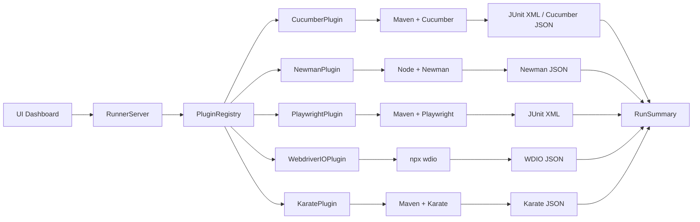

# Requirements

### Overview & Goals
Transform the Unified QA Runner from a Maven/Newman-only test executor into a **multi-framework test orchestration platform** where users drop test scripts into framework-specific folders and run them from a unified UI dashboard — without needing testing expertise.

### Scope

**In Scope:**
- Plugin-based architecture for framework execution (RunnerPlugin interface)
- Support for 6 frameworks: Selenium+Cucumber, Playwright (Java), WebdriverIO, RestAssured, Postman/Newman, Karate DSL
- Framework subfolder organization: `tests/playwright/`, `tests/karate/`, `tests/wdio/`, `tests/selenium/`, `tests/api/`
- Auto-discovery of test scripts per framework
- Unified UI dashboard with framework selector, asset picker, target URL, browser selection, and execution results
- Per-framework report parsing (JSON, HTML, XML) into the unified `RunSummary` format
- Collection runs across frameworks

**Out of Scope:**
- Mobile testing (Appium, Espresso)
- Performance/load testing (JMeter, Gatling)
- Distributed/parallel execution across machines
- CI/CD pipeline integration (GitHub Actions, Jenkins plugins)

### User Stories
1. As a QA engineer, I want to drop Playwright test files into `tests/playwright/` so they appear in the UI dashboard automatically.
2. As a tester, I want to select a framework (e.g., Karate) and run its tests from the UI without knowing Maven or Node.js commands.
3. As a team lead, I want to see pass/fail results from all frameworks in a unified report with screenshots for failures.
4. As a developer, I want to add a new test framework by implementing a single `RunnerPlugin` class without modifying core runner code.

### Functional Requirements
- **Framework discovery**: Each plugin scans its designated folder for test scripts and returns a list of runnable assets.
- **Framework execution**: The runner invokes the correct command (Maven, npx, node, java) with framework-specific arguments.
- **Report parsing**: Each plugin parses its framework's output format into the unified `RunSummary` + `RunDetail` model.
- **UI framework selector**: A dropdown or tab to switch between frameworks when browsing assets.
- **Collection runs**: Ability to select multiple tests across the same framework and run them together.
- **Browser selection**: Chrome/Firefox checkboxes (existing) extended to frameworks that support browsers.

### Non-Functional Requirements
- **Extensibility**: Adding a new framework requires only a new plugin class and optional config — no changes to core server or UI.
- **Isolation**: Each framework runs in its own process; a crash in one doesn't affect others.
- **Security**: Non-local targets still require authorization checkbox; script execution is sandboxed to project directories.

# Technical Design

### Current Implementation
The runner currently has a flat `ExecutionService.Kind` enum with 5 types (SELENIUM_CLASS, CUCUMBER_FEATURE, REST_ASSURED_CLASS, REST_ASSURED_FEATURE, NEWMAN_COLLECTION). All execution logic lives in `ExecutionService.java` (791 lines) with hardcoded Maven and Node.js commands. `ProjectCatalog.java` discovers assets by scanning `src/test/java`, `src/test/resources/features`, and `src/test/resources/api`. `RunnerServer.java` handles the HTTP API and dispatches to `ExecutionService`.

### Key Decisions
1. **Plugin interface over config-driven**: User chose plugin-based runner. Each framework implements `RunnerPlugin` with `discover()`, `execute()`, and `cancel()` methods. This type-safe approach keeps execution logic in Java where we can validate targets, handle errors, and parse reports reliably.
2. **Framework subfolders**: Tests organized under `tests/<framework>/` (e.g., `tests/playwright/`, `tests/karate/`, `tests/wdio/`). Each folder can contain its own `pom.xml`, `package.json`, or config files.
3. **Plugin registry**: A `PluginRegistry` class auto-discovers plugins via `ServiceLoader` or manual registration, eliminating the need to modify core code when adding frameworks.
4. **Backward compatibility**: Existing tests in `src/test/` continue to work. The CucumberPlugin and NewmanPlugin will scan both the old paths and the new `tests/` paths.

### Proposed Changes

#### 1. Plugin Infrastructure (new files)
- **`RunnerPlugin.java`** — interface with methods:
  - `String name()` — framework name (e.g., "Playwright")
  - `String label()` — display label (e.g., "Playwright Java test")
  - `List<String> discover(Path projectRoot)` — returns list of runnable asset paths
  - `RunResult execute(String selection, String targetUrl, boolean authorized, boolean headless, List<String> browsers, Consumer<String> output)` — runs a single test
  - `void cancel()` — stops the current run
- **`PluginRegistry.java`** — manages plugin lifecycle:
  - `List<RunnerPlugin> plugins()` — returns all registered plugins
  - `RunnerPlugin findByName(String name)` — lookup by framework name
  - `Map<String, List<String>> discoverAll(Path projectRoot)` — aggregated catalog from all plugins

#### 2. Framework Plugins (new files)
- **`CucumberPlugin.java`** — wraps existing Cucumber/Selenium logic from `ExecutionService`. Scans `src/test/resources/features/` and `tests/selenium/`.
- **`NewmanPlugin.java`** — wraps existing Newman logic. Scans `src/test/resources/api/` and `tests/api/`.
- **`PlaywrightPlugin.java`** — discovers `.java` files in `tests/playwright/`, executes via `mvn test` with Playwright dependencies, parses JUnit XML reports.
- **`WebdriverIOPlugin.java`** — discovers `.js`/`.ts` files in `tests/wdio/`, executes via `npx wdio`, parses JSON/Wdio reports.
- **`KaratePlugin.java`** — discovers `.feature` files in `tests/karate/`, executes via `mvn test` with Karate dependencies, parses Karate JSON reports.

#### 3. Core Refactoring
- **`ExecutionService.java`** — refactored to delegate to `PluginRegistry` instead of containing all logic. The `Kind` enum is replaced by plugin names.
- **`RunnerServer.java`** — updated to use `PluginRegistry` for catalog and execution. API endpoints remain the same (`/api/catalog`, `/api/runs`, etc.).
- **`ProjectCatalog.java`** — replaced by `PluginRegistry.discoverAll()`.

#### 4. UI Changes
- **`index.html`** — added framework selector dropdown above the asset picker. When a framework is selected, only that framework's assets show. The "Run" button sends the framework name to the API.

### File Structure
```
src/main/java/com/example/unifiedqarunner/
  RunnerPlugin.java              (new — interface)
  PluginRegistry.java            (new — registry)
  plugin/
    CucumberPlugin.java          (new — wraps existing Cucumber logic)
    NewmanPlugin.java            (new — wraps existing Newman logic)
    PlaywrightPlugin.java        (new — Playwright Java support)
    WebdriverIOPlugin.java       (new — WebdriverIO support)
    KaratePlugin.java            (new — Karate DSL support)
  ExecutionService.java          (refactored — delegates to plugins)
  RunnerServer.java              (refactored — uses PluginRegistry)
  ProjectCatalog.java            (deprecated — replaced by PluginRegistry)
  RunSummary.java                (unchanged)
  RunDetail.java                 (unchanged)
  ReportWriter.java              (unchanged)
  JsonParser.java                (unchanged)

src/main/resources/static/
  index.html                     (updated — framework selector)

tests/                           (new — user script folders)
  playwright/                    (new — Playwright test scripts)
  wdio/                          (new — WebdriverIO test scripts)
  karate/                        (new — Karate feature files)
  selenium/                      (new — Selenium/Cucumber scripts)
  api/                           (new — Newman collections)
```

### Architecture Diagram


### Risks
- **Playwright Java requires Maven dependency setup**: Users need a `pom.xml` in `tests/playwright/` with Playwright dependencies. We'll provide a template.
- **WebdriverIO requires Node.js**: Users need `npm install` in `tests/wdio/`. We'll provide a template `package.json`.
- **Karate requires Maven dependency**: Similar to Playwright, a template `pom.xml` is needed.
- **Report parsing varies**: Each framework outputs different report formats. The plugin must parse correctly into `RunSummary`.

# Testing

### Validation Approach
Each plugin will be validated by running a sample test through the UI and verifying the results appear correctly in the dashboard.

### Key Scenarios
1. **CucumberPlugin**: Run `home_page.feature` via UI → 1 passed, 0 failed, 0 skipped.
2. **NewmanPlugin**: Run `local-health.postman_collection.json` → 5 passed, 0 failed.
3. **PlaywrightPlugin**: Run a sample Playwright test → results appear in dashboard with pass/fail counts.
4. **KaratePlugin**: Run a sample Karate feature → results parsed from Karate JSON report.
5. **WebdriverIOPlugin**: Run a sample WDIO spec → results parsed from WDIO JSON report.
6. **Collection run**: Select multiple Cucumber features → all run and aggregated.
7. **Framework switching**: Switch between frameworks in UI → asset list updates correctly.

### Edge Cases
- Empty framework folder → no assets shown, no errors.
- Framework with no tests matching selection → clear error message.
- Run cancelled mid-execution → plugin's `cancel()` stops the process.
- Report file missing after run → fallback to exit-code-based summary.

# Delivery Steps

### ✓ Step 1: Create plugin infrastructure
Add RunnerPlugin interface and PluginRegistry, then refactor ExecutionService to delegate to plugins.
- Create `RunnerPlugin.java` interface with `name()`, `label()`, `discover()`, `execute()`, and `cancel()` methods.
- Create `PluginRegistry.java` with plugin registration, lookup, and aggregated discovery.
- Refactor `ExecutionService.java` to use `PluginRegistry` instead of hardcoded `Kind` enum logic.
- Update `RunnerServer.java` to use `PluginRegistry` for catalog and execution dispatch.
- Deprecate `ProjectCatalog.java` (replace with `PluginRegistry.discoverAll()`).

### ✓ Step 2: Implement Cucumber and Newman plugins
Wrap existing Cucumber and Newman execution logic into standalone plugins.
- Create `CucumberPlugin.java` — extract Cucumber/Selenium execution from `ExecutionService`, scan both `src/test/resources/features/` and `tests/selenium/`.
- Create `NewmanPlugin.java` — extract Newman execution from `ExecutionService`, scan both `src/test/resources/api/` and `tests/api/`.
- Register both plugins in `PluginRegistry`.
- Verify existing tests still work: `mvn test` passes, UI runs Cucumber and Newman tests correctly.

### ✓ Step 3: Implement Playwright plugin
Add Playwright Java support with auto-discovery and Maven-based execution.
- Create `PlaywrightPlugin.java` — discovers `.java` test files in `tests/playwright/`, executes via `mvn test` with Playwright-specific args, parses JUnit XML reports.
- Create template `tests/playwright/pom.xml` with Playwright dependencies.
- Create sample Playwright test in `tests/playwright/` for validation.
- Register plugin in `PluginRegistry`.
- Verify: run sample Playwright test via UI, check results in dashboard.

### ✓ Step 4: Implement Karate plugin
Add Karate DSL support with Maven-based execution and Karate JSON report parsing.
- Create `KaratePlugin.java` — discovers `.feature` files in `tests/karate/`, executes via `mvn test` with Karate-specific args, parses Karate JSON reports into `RunSummary`.
- Create template `tests/karate/pom.xml` with Karate dependencies.
- Create sample Karate feature in `tests/karate/` for validation.
- Register plugin in `PluginRegistry`.
- Verify: run sample Karate feature via UI, check results in dashboard.

### ✓ Step 5: Implement WebdriverIO plugin
Add WebdriverIO support with Node.js-based execution and WDIO report parsing.
- Create `WebdriverIOPlugin.java` — discovers `.js`/`.ts` spec files in `tests/wdio/`, executes via `npx wdio`, parses WDIO JSON reports.
- Create template `tests/wdio/package.json` and `wdio.conf.js`.
- Create sample WDIO spec in `tests/wdio/` for validation.
- Register plugin in `PluginRegistry`.
- Verify: run sample WDIO spec via UI, check results in dashboard.

### ✓ Step 6: Update UI with framework selector
Add framework selector to the UI dashboard so users can switch between frameworks.
- Update `index.html` — add framework dropdown above the asset picker. When a framework is selected, filter assets to show only that framework's tests.
- Update `renderAssetOptions()` and `renderAssets()` to use the selected framework.
- Update `runTest()` and `runCollection()` to send the framework name to the API.
- Update `/api/catalog` response to include `framework` field per asset.
- Verify: switch between frameworks in UI, asset list updates, tests run correctly.

### ✓ Step 7: Shared script paths support
Allow users to deploy test scripts to a shared folder and have them auto-discovered by the UI.
- Create `SharedPathConfig.java` — manages shared path configuration in `qa-runner.json`.
- Update `RunnerPlugin.java` — added `discover(Path, List<Path>)` method for shared paths.
- Update `PluginRegistry.java` — pass shared paths to all plugins during discovery.
- Update `CucumberPlugin.java`, `NewmanPlugin.java`, `PlaywrightPlugin.java` — scan shared paths for their respective file types.
- Update `RunnerServer.java` — added `/api/shared-paths` endpoints (GET/POST/DELETE), catalog includes shared paths.
- Update `index.html` — added "Shared script paths" panel with add/remove functionality.
- Add `SharedPathConfig.findSharedPath()` method for lookup by name.
- Add `/api/shared-paths/{name}/scan` endpoint — scans a shared path and returns detected frameworks with asset counts.
- Add "🔍 Scan" button to each shared path entry in the UI — shows framework detection results inline.
- Update `index.html` — `scanSharedPath()` function displays detected frameworks, asset counts, and file names.
- Verify: Playwright example deployed to `C:\shared\playwright-tests\`, discovered and executed via UI with 3/3 tests passed.
- Verify: Scan endpoint returns framework info (Playwright Java: 1 test) and auto-refreshes the catalog.
- Update `WebdriverIOPlugin.java` — added shared path discovery (`discover(Path, List<Path>)`) and shared path execution support.
- Update `CucumberPlugin.java` — skip `node_modules` directories when scanning shared paths to avoid false positives.
- Update `WebdriverIOPlugin.java` — added log-based report parsing fallback for WDIO spec reporter output.
- Create WebdriverIO example at `C:\shared\wdio-tests/` with `package.json`, `wdio.conf.js`, and `demoqa-homepage.spec.js`.
- Verify: WDIO example deployed to `C:\shared\wdio-tests\`, discovered and executed via UI with 3/3 tests passed.
- Verify: Scan endpoint detects WebdriverIO framework with 1 test asset.
- Update `KaratePlugin.java` — added shared path discovery (`discover(Path, List<Path>)`) and shared path execution support with surefire report parsing.
- Create Karate example at `C:\shared\karate-tests/` with `pom.xml`, `PostsTest.java`, and `posts.feature` (5 API test scenarios).
- Verify: Karate example deployed to `C:\shared\karate-tests\`, discovered and executed via UI with 5/5 tests passed.
- Verify: Scan endpoint detects Karate framework with 1 test asset.